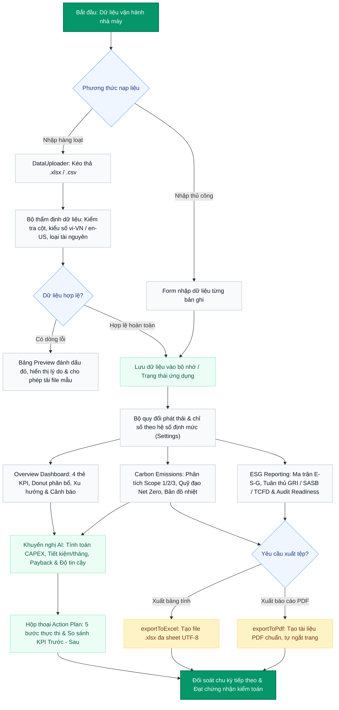
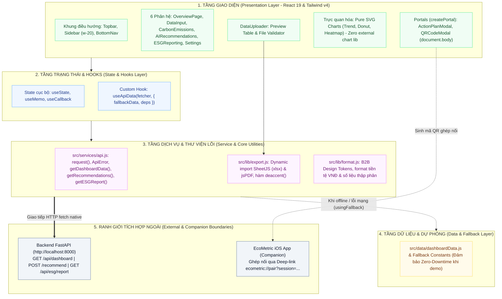

<div align="center">

# 🌿 EcoMetric Web Dashboard

**Nền tảng quản trị chỉ số ESG, kiểm kê phát thải Carbon (Scope 1/2/3) và tối ưu hóa năng lượng cho doanh nghiệp.**

Chuyển đổi dữ liệu vận hành thô (điện, nước, nhiên liệu) thành quyết định giảm phát thải và chi phí có thể đo lường.

[](https://react.dev)
[](https://vite.dev)
[](https://tailwindcss.com)
[](https://oxc.rs)
[](https://sheetjs.com)
[](https://github.com/parallax/jsPDF)
[](https://lucide.dev)

</div>

---

## 1. Tổng quan & Vòng lặp vận hành

**EcoMetric Web Dashboard** là hệ thống quản trị dữ liệu môi trường và phát thải dành cho doanh nghiệp sản xuất và các tổ chức cần công bố trách nhiệm bền vững. Thay vì quản lý dữ liệu qua các bảng tính rời rạc dễ sai sót, EcoMetric tập trung hóa toàn bộ dữ liệu tài nguyên vận hành (điện lưới, nước sạch, xăng dầu, nguyên vật liệu), tự động quy đổi tương đương CO₂e theo chuẩn quốc tế **GHG Protocol (Scope 1, 2, 3)** và đối chiếu với các khung báo cáo bền vững hàng đầu (**GRI, SASB, TCFD**).

Mục tiêu cốt lõi của nền tảng là giúp doanh nghiệp kiểm soát chi phí năng lượng, phát hiện điểm bất thường trong vận hành và lập kế hoạch giảm phát thải khả thi với thời gian hoàn vốn (Payback) và suất sinh lời (ROI) minh bạch.

### Vòng lặp vận hành khép kín (The Closed-Loop Cycle)

EcoMetric được thiết kế xoay quanh chu trình vận hành khép kín 5 giai đoạn liên tục. Giá trị cốt lõi không dừng lại ở một báo cáo tĩnh tại một thời điểm, mà nằm ở việc lặp lại chu kỳ để liên tục tối ưu hóa hiệu quả:

```text
   ┌────────────────┐      ┌────────────────┐      ┌────────────────┐
   │   ① Measure    │ ───▶ │   ② Insight    │ ───▶ │   ③ Decide     │
   │  Đo lường &    │      │  Quy đổi &     │      │  Đánh giá &    │
   │  Nạp dữ liệu   │      │  Phân tích     │      │  Chọn giải pháp│
   └────────────────┘      └────────────────┘      └────────────────┘
           ▲                                               │
           │                                               ▼
   ┌────────────────┐                             ┌────────────────┐
   │  ⑤ Remeasure   │ ◀────────────────────────── │    ④ Act       │
   │  Đối soát &    │                             │  Thực thi theo │
   │  Kiểm chứng    │                             │  Action Plan   │
   └────────────────┘                             └────────────────┘
```

1. **Measure (Đo lường & Nạp liệu):** Thu thập dữ liệu thực tế từ dây chuyền và nhà máy. Người dùng có thể nạp nhanh dữ liệu tiêu thụ điện (kWh), nước sạch (m³), dầu diesel/xăng (Lít) và nguyên liệu (kg) bằng form nhập tay hoặc kéo thả hàng loạt qua tệp Excel/CSV với bộ kiểm tra lỗi tự động.
2. **Insight (Quy đổi & Phân tích):** Dữ liệu được tính toán tự động dựa trên hệ số phát thải định mức theo vùng. Hệ thống phân bổ phát thải theo Scope 1, Scope 2, Scope 3, xác định cơ cấu chi phí, vẽ biểu đồ xu hướng và so sánh trực tiếp với quỹ đạo cam kết Net Zero 2030.
3. **Decide (Đánh giá & Chọn giải pháp):** Động cơ phân tích đối chiếu định mức tiêu thụ với lịch sử vận hành để phát hiện bất thường (rò rỉ nước, thiết bị non tải, hệ số công suất thấp). Mô hình AI lượng hóa và sắp xếp mức độ ưu tiên theo hiệu quả kinh tế: Chi phí đầu tư (CAPEX), số tiền tiết kiệm mỗi tháng và lượng tCO₂e cắt giảm.
4. **Act (Thực thi theo kế hoạch):** Mỗi giải pháp được gắn kèm một Action Plan chuẩn hóa gồm 5 bước triển khai tuần tự, phân công phòng ban phụ trách, mốc thời gian và bảng chỉ số kỳ vọng Trước – Sau.
5. **Remeasure (Đối soát & Kiểm chứng):** Sau khi thực thi, dữ liệu vận hành chu kỳ mới được nạp vào để đối soát mức giảm thực tế so với mục tiêu. Kết quả được đóng gói thành báo cáo kiểm toán đạt chuẩn GRI/SASB để phục vụ báo cáo cổ đông và đối tác kiểm toán.

---

## 2. Product Workflow (Luồng vận hành sản phẩm)

Quy trình xử lý dữ liệu từ đầu vào đến kết xuất báo cáo và đối soát được mô tả qua sơ đồ luồng dưới đây:



---

## 3. Demo Journey (Kịch bản trải nghiệm thực tế)

Để người xem hoặc người đánh giá nắm bắt toàn diện ứng dụng trong 5–10 phút, kịch bản trải nghiệm thực tế trên giao diện web được thiết kế liền mạch theo 7 bước:

```text
[1. Tổng quan] ──▶ [2. Nhập liệu] ──▶ [3. Phát thải] ──▶ [4. Khuyến nghị AI] ──▶ [5. Báo cáo ESG] ──▶ [6. Cài đặt] ──▶ [7. Ghép nối QR]
```

### Bước 1: Khám phá bức tranh tổng thể tại Dashboard (`overview`)
Người dùng bắt đầu tại màn hình **Tổng quan Vận hành & Phát thải**. Giao diện hiển thị ngay 4 thẻ KPI đồng nhất (Tổng phát thải CO₂e, Chi phí năng lượng, Bản ghi vận hành, Tiết kiệm tiềm năng) với số liệu căn lề dạng bảng (`tabular-nums`). Quan sát thanh trạng thái nhỏ ở góc phải tiêu đề: nhãn hiển thị *Dữ liệu mô phỏng* (màu hổ phách) khi chạy độc lập hoặc *Trực tuyến* (xanh lá) khi đã kết nối FastAPI. Thử chuyển đổi nhanh bộ lọc *Kỳ dữ liệu* (Tháng / Quý / Năm) và *Cơ sở* (Xưởng 1 / Xưởng 2 / Toàn bộ cơ sở). Tại khối **Top 3 việc cần làm ngay trong tháng**, bấm vào một thẻ để mở hộp thoại Action Plan 5 bước ngay trên màn hình.

### Bước 2: Trải nghiệm kiểm soát chất lượng dữ liệu tại Nhập liệu (`operations`)
Chuyển sang phân hệ **Dữ liệu vận hành** qua Sidebar hoặc BottomNav. Tại đây, nhấn nút *Tải file mẫu (.xlsx)* để trình duyệt sinh ngay một bảng tính đúng định dạng chuẩn. Kéo thả một tệp dữ liệu vào vùng `DataUploader.jsx`. Trình duyệt lập tức phân tích và hiển thị **Bảng xem trước (Preview Table)**: dòng hợp lệ có biểu tượng xanh, dòng sai định dạng số hoặc thiếu cơ sở sẽ được tô màu đỏ cảnh báo. Hệ thống xử lý thông minh cả định dạng số kiểu Việt Nam (`1.250,5`) lẫn quốc tế (`1250.5`), giúp người dùng an tâm trước khi bấm *Lưu vào hệ thống*.

### Bước 3: Phân tích chuyên sâu tại Phát thải Carbon (`carbon`)
Truy cập trang **Phát thải Carbon** để kiểm kê chi tiết theo 3 phạm vi: Scope 1 (nhiên liệu trực tiếp), Scope 2 (điện năng gián tiếp) và Scope 3 (chuỗi cung ứng). Mỗi thẻ đều có thanh tiến độ thể hiện tỷ lệ tiêu thụ so với hạn mức Net Zero 2030. Quan sát biểu đồ xu hướng thực tế đối chiếu với quỹ đạo cam kết. Phía dưới, chuyển đổi giữa chế độ xem *Phát thải tuyệt đối* (tấn CO₂e) và *Cường độ phát thải* trên **Bản đồ nhiệt** theo từng nhà xưởng. Cuối cùng, thử nghiệm nút *Xuất dữ liệu Excel* (tải về tệp `.xlsx` đa sheet) hoặc *Tải báo cáo PDF* (tạo tài liệu PDF chính thức với bộ đếm trang tự động).

### Bước 4: Lập kế hoạch hành động với Khuyến nghị AI (`ai`)
Mở trang **Khuyến nghị AI** để xem các cơ hội tối ưu hóa năng lượng do hệ thống đề xuất. 4 thẻ tổng hợp trên cùng cho biết tổng số tiền có thể tiết kiệm mỗi năm và mức giảm phát thải kỳ vọng. Lọc danh sách giải pháp theo lĩnh vực (*Điện năng*, *Nhiên liệu*, *Quy trình*) hoặc mức ưu tiên. Mỗi thẻ giải pháp cung cấp đầy đủ: căn cứ dữ liệu thực tế phát hiện được, độ tin cậy của thuật toán (%), chi phí đầu tư (CAPEX), số tiền tiết kiệm và thời gian hoàn vốn (Payback). Nhấn *Xem cách triển khai* để xem quy trình 5 bước và bảng so sánh trực quan chỉ số KPI *Trước ➔ Sau* khi áp dụng.

### Bước 5: Kiểm tra tính sẵn sàng kiểm toán tại Báo cáo ESG (`esg`)
Tại phân hệ **Báo cáo ESG**, giao diện hiển thị bảng đo lường tiến độ chuẩn hóa theo 3 khung chuẩn quốc tế: GRI Standards, SASB và TCFD. Bên dưới là bảng chỉ số chi tiết cho từng trụ cột **E (Môi trường)**, **S (Xã hội)** và **G (Quản trị)** kèm trạng thái tuân thủ và mức độ sẵn sàng kiểm toán (*Audit Readiness* đạt từ 70% đến 95%). Người dùng có thể nhấn *Xuất dữ liệu Excel* để nhận tệp bảng tính có từng sheet riêng biệt cho từng trụ cột E, S, G.

### Bước 6: Tùy biến cấu hình doanh nghiệp tại Cài đặt (`settings`)
Chuyển tới trang **Cài đặt** để quan sát khả năng mở rộng của hệ thống. 5 khối chức năng được bố trí mạch lạc: chỉnh sửa thông tin doanh nghiệp (tên, mã số thuế, mã ngành VSIC, chứng nhận ISO 14001/50001), quản lý danh sách nhà xưởng và diện tích, tùy chỉnh hệ số phát thải quy đổi so với mốc tham chiếu chuẩn, thiết lập ngưỡng cảnh báo vượt định mức (%) kèm kênh thông báo, và bảng ma trận phân quyền người dùng (Admin, Auditor, Factory Manager).

### Bước 7: Trải nghiệm cầu nối thiết bị di động (`QRCodeCard.jsx`)
Tại thanh Topbar trên cùng, bấm vào biểu tượng mã QR. Hộp thoại **Mở EcoMetric trên thiết bị di động** xuất hiện ngay giữa màn hình thông qua React Portal (không bị ảnh hưởng bởi thanh header kính mờ). Mã QR chứa URL web trực tiếp (tự động ưu tiên IP LAN máy tính qua Wi-Fi khi chạy dev server). Khi dùng camera điện thoại quét mã hoặc mở liên kết trực tiếp, người dùng được đưa thẳng vào bảng điều khiển web ngay lập tức mà không cần qua màn hình xác nhận trung gian; tham số phiên được tự động làm sạch khỏi thanh địa chỉ. Người dùng cũng có thể bấm *Mô phỏng quét từ iOS App*, tải ảnh QR PNG hoặc sao chép nhanh liên kết web truy cập.

---

## 4. Bảng Tính năng (Feature Matrix)

Bảng dưới đây đối chiếu chi tiết giữa thiết kế tính năng, thành phần mã nguồn hiện hữu trong dự án và trạng thái thực tế:

| Phân hệ / Thành phần | Mã nguồn đảm nhiệm | Nội dung tính năng chi tiết | Trạng thái kỹ thuật trong code |
| :--- | :--- | :--- | :--- |
| **Tổng quan (Overview)** | `src/App.jsx`<br>`src/components/MetricsCard.jsx`<br>`src/components/TrendChartCard.jsx`<br>`src/components/ActionPriorityCard.jsx`<br>`src/components/ResourceDonutCard.jsx` | 4 thẻ KPI vận hành, biểu đồ xu hướng tài nguyên (SVG thuần), donut cơ cấu năng lượng, cảnh báo bất thường, danh sách báo cáo gần đây và top 3 việc cần làm ngay. | **Hoàn thiện**: Tích hợp hook `useApiData`. Gọi API `/api/dashboard`, tự động fallback sang `src/data/dashboardData.js` khi backend chưa bật. |
| **Dữ liệu vận hành (Operations)** | `src/DataInput.jsx`<br>`src/components/DataUploader.jsx` | Quản lý bảng dữ liệu nhập tay; khu vực kéo thả tệp Excel/CSV; bộ phân tích và kiểm tra lỗi dữ liệu; nhận diện số vi-VN/en-US; tự sinh file mẫu `.xlsx`. | **Hoàn thiện**: Hoạt động 100% phía client, import động thư viện SheetJS `xlsx`, kiểm tra tính hợp lệ từng dòng trước khi ghi vào state. |
| **Phát thải Carbon (Carbon)** | `src/CarbonEmissions.jsx`<br>`src/lib/export.js` | Kiểm kê phát thải Scope 1, Scope 2, Scope 3 theo GHG Protocol; so sánh quỹ đạo Net Zero 2030; bản đồ nhiệt phân bổ theo nhà máy; xuất báo cáo Excel/PDF. | **Hoàn thiện**: Chạy độc lập trên dữ liệu mẫu chuẩn; biểu đồ SVG thuần; tích hợp chức năng xuất tệp đa sheet và PDF tải về trực tiếp. |
| **Khuyến nghị AI (AI)** | `src/AIRecommendations.jsx`<br>`src/components/ActionPlanModal.jsx` | 4 KPI kinh tế kỹ thuật (CAPEX, Tiết kiệm, Giảm phát thải, Payback); bộ lọc lĩnh vực & ưu tiên; danh sách thẻ giải pháp minh bạch căn cứ tính toán; modal Action Plan 5 bước. | **Hoàn thiện**: Tích hợp hook `useApiData`. Gọi API `POST /recommend`, tự động fallback sang dữ liệu giải pháp mẫu chuẩn khi chưa kết nối API. |
| **Báo cáo ESG (ESG)** | `src/ESGReporting.jsx`<br>`src/lib/export.js` | Đánh giá tuân thủ 3 khung tiêu chuẩn (GRI, SASB, TCFD); bảng ma trận chỉ số E-S-G kèm tỷ lệ sẵn sàng kiểm toán; xuất dữ liệu báo cáo chuyên biệt. | **Hoàn thiện**: Tích hợp hook `useApiData`. Gọi API `/api/esg/report`, tự động fallback sang dữ liệu chỉ số mẫu; hỗ trợ xuất Excel và PDF. |
| **Cài đặt hệ thống (Settings)** | `src/Settings.jsx` | Cấu hình hồ sơ doanh nghiệp; quản lý danh sách nhà xưởng; điều chỉnh hệ số phát thải theo cơ sở; cài đặt ngưỡng cảnh báo tiêu thụ; quản lý tài khoản & phân quyền. | **Hoàn thiện**: Quản lý trạng thái cục bộ (`useState`), có thông báo phản hồi (Toast), form nhập liệu và bảng tra cứu tối ưu hóa tương tác. |
| **Service Layer & API** | `src/services/api.js`<br>`src/hooks/useApiData.js` | Điểm tập trung duy nhất gọi HTTP tới FastAPI; bọc timeout `AbortController`; phân loại lỗi `ApiError`; hook quản lý vòng đời request và fallback an toàn. | **Hoàn thiện**: Viết bằng native `fetch`, sẵn sàng kết nối Backend FastAPI tại `VITE_API_BASE_URL`, không làm sập giao diện khi mất kết nối. |
| **Xuất tệp nâng cao (Export)** | `src/lib/export.js` | Xuất workbook Excel `.xlsx` nhiều sheet giữ nguyên dấu tiếng Việt; xuất báo cáo PDF chuẩn hóa qua thuật toán `deaccent` xử lý font Latin-1. | **Hoàn thiện**: Áp dụng dynamic import cho `xlsx` (~424 kB) và `jspdf` (~399 kB), tách riêng chunk để tối ưu thời gian tải trang ban đầu. |
| **Mở nhanh & Ghép nối QR** | `src/QRCodeCard.jsx` | Nút mở mã QR trên Topbar; sinh URL web trực tiếp (tự động ưu tiên IP LAN máy tính); render qua `createPortal`; vào thẳng Dashboard khi quét; hỗ trợ mô phỏng kết nối iOS. | **Hoàn thiện**: Sinh mã QR chuẩn SVG kèm logo ở giữa; link web truy cập trực tiếp; tự làm sạch URL; cơ chế Portal chống lỗi containing-block. |

---

## 5. Kiến trúc hệ thống (System Architecture)

Kiến trúc EcoMetric Web Dashboard được xây dựng theo mô hình phân tầng hướng module (Layered Modular Architecture). Cấu trúc này tách biệt rõ ràng giữa tầng hiển thị giao diện, tầng quản lý trạng thái, tầng dịch vụ mạng và các ranh giới tích hợp bên ngoài.



### Các nguyên tắc kiến trúc nổi bật

- **Tách biệt ranh giới gọi mạng:** Toàn bộ lệnh gọi mạng tập trung tại `src/services/api.js`. Component tuyệt đối không sử dụng `fetch` tùy tiện, giúp việc bảo trì, thay đổi endpoint hoặc chuyển đổi sang Axios trong tương lai không làm ảnh hưởng tới giao diện.
- **Cơ chế Fallback bảo toàn hiển thị:** Thông qua hook `useApiData`, nếu Backend FastAPI chưa khởi động hoặc gặp sự cố mạng, hệ thống tự động cung cấp dữ liệu mô phỏng dự phòng (`fallbackData`) và bật cờ `usingFallback`. Nhờ đó, ứng dụng không bao giờ bị trắng trang hay gián đoạn khi trình diễn.
- **Tối ưu dung lượng tải ban đầu (Code Splitting):** Hai thư viện có dung lượng lớn là `xlsx` (~424 kB) và `jspdf` (~399 kB) được nạp thông qua cú pháp import động (`await import(...)`). Trình duyệt chỉ tải các tệp này khi người dùng chủ động bấm nút xuất báo cáo.
- **Tránh phụ thuộc thư viện biểu đồ cồng kềnh:** Các biểu đồ đường, biểu đồ tròn (donut), biểu đồ nhiệt và thanh hạn mức đều được vẽ bằng SVG thuần với toán học tọa độ chuẩn xác. Điều này giúp bundle ứng dụng nhẹ, khởi động nhanh và tùy biến giao diện linh hoạt theo Tailwind CSS v4.
- **Khắc phục lỗi Containing-Block bằng React Portals:** Các modal quan trọng (`ActionPlanModal`, `QRCodeCard`) được đưa ra ngoài cây DOM thông qua `createPortal(..., document.body)`. Kỹ thuật này ngăn chặn hiện tượng lớp nền kính mờ (`backdrop-filter`) của thanh Header biến thành khối chứa neo tọa độ, đảm bảo hộp thoại luôn hiển thị chính giữa toàn bộ màn hình.

---

## 6. Hướng dẫn cài đặt & Chạy dự án

### Yêu cầu môi trường

- **Node.js**: Phiên bản 18.0.0 trở lên (khuyến nghị Node 20 LTS).
- **Trình quản lý gói**: `npm` (đi kèm Node.js) hoặc `pnpm` / `yarn`.

### Các bước cài đặt

Di chuyển vào thư mục ứng dụng và cài đặt các gói phụ thuộc:

```bash
cd ecometric-app
npm install
```

### Cấu hình biến môi trường (Tùy chọn)

Để kết nối với Backend FastAPI thật, tạo tệp `.env.local` trong thư mục `ecometric-app/` dựa trên mẫu `.env.example`:

```bash
cp .env.example .env.local
```

Nội dung cấu hình mẫu trong `.env.local`:

```dotenv
# Địa chỉ máy chủ FastAPI (mặc định nếu không cấu hình là http://localhost:8000)
VITE_API_BASE_URL=http://localhost:8000

# Thời gian chờ tối đa cho mỗi yêu cầu HTTP (tính theo mili-giây)
VITE_API_TIMEOUT_MS=15000
```

*Lưu ý: Nếu không tạo file `.env.local`, ứng dụng vẫn tự động hoạt động bình thường trên dữ liệu mô phỏng chuẩn.*

### Khởi chạy môi trường phát triển (Development)

Chạy máy chủ phát triển Vite với tính năng Hot Module Replacement (HMR):

```bash
npm run dev
```

Mở trình duyệt và truy cập vào địa chỉ hiển thị trên terminal (thông thường là `http://localhost:5173`).

### Kiểm tra chất lượng mã nguồn (Linting)

Dự án sử dụng **Oxlint** tốc độ cao để rà soát lỗi cú pháp và chuẩn mực mã nguồn:

```bash
npm run lint
```

### Đóng gói cho môi trường Production (Build)

Biên dịch và tối ưu hóa toàn bộ mã nguồn vào thư mục `dist/`:

```bash
npm run build
```

### Xem thử bản đóng gói (Preview)

Khởi chạy máy chủ cục bộ để kiểm tra tệp sau khi build production:

```bash
npm run preview
```

### Bảng tổng hợp lệnh

| Lệnh | Ý nghĩa và mục đích |
| :--- | :--- |
| `npm run dev` | Khởi động máy chủ phát triển Vite tại cổng 5173 với HMR. |
| `npm run lint` | Chạy Oxlint quét toàn bộ 28 tệp mã nguồn để kiểm tra lỗi cú pháp và quy tắc code. |
| `npm run build` | Biên dịch toàn bộ ứng dụng sang mã tĩnh tại thư mục `dist/` phục vụ triển khai production. |
| `npm run preview` | Khởi chạy máy chủ nội bộ để kiểm tra trực tiếp sản phẩm sau khi build. |

---

## 7. Cấu trúc thư mục dự án

Cấu trúc mã nguồn chi tiết của `ecometric-app/` được tổ chức khoa học và nhất quán:

```text
ecometric-app/
├── public/                         # Tệp tĩnh phục vụ trực tiếp không qua biên dịch
│   ├── favicon.svg                 # Biểu tượng chiếc lá thương hiệu EcoMetric
│   └── icons.svg                   # Bộ ký hiệu vector dùng chung
├── src/
│   ├── assets/                     # Tài nguyên đồ họa (hero.png, react.svg, vite.svg)
│   ├── components/                 # Các khối giao diện dùng lại theo nguyên tắc nguyên tử
│   │   ├── ActionPlanModal.jsx     # Hộp thoại quy trình 5 bước & so sánh KPI (Portal)
│   │   ├── ActionPriorityCard.jsx  # Danh sách thẻ việc cần làm ngay trong tháng
│   │   ├── AiSuggestionsCard.jsx   # Thẻ khuyến nghị ngắn gọn trên Dashboard
│   │   ├── AlertsCard.jsx          # Thẻ danh sách cảnh báo vận hành bất thường
│   │   ├── BottomNav.jsx           # Thanh điều hướng đáy dành cho màn hình di động (< lg)
│   │   ├── DataProvenanceTag.jsx   # Pill nhãn nguồn gốc số liệu (Trực tuyến / Mô phỏng)
│   │   ├── DataUploader.jsx        # Khu vực kéo thả Excel/CSV, bảng Preview & Validator
│   │   ├── MetricsCard.jsx         # Hệ thống 4 thẻ chỉ số KPI chính
│   │   ├── RecentReportsList.jsx   # Danh sách báo cáo gần đây (Card list / Bảng)
│   │   ├── ResourceDonutCard.jsx   # Biểu đồ tròn (Donut SVG) phân bổ cơ cấu tài nguyên
│   │   ├── Sidebar.jsx             # Thanh điều hướng bên trái dành cho màn hình lớn (≥ lg)
│   │   ├── Topbar.jsx              # Thanh đầu trang (Logo, tìm kiếm ⌘K, nút QR, Avatar)
│   │   ├── TrendChartCard.jsx      # Biểu đồ xu hướng tiêu thụ tài nguyên (SVG thuần)
│   │   └── UploadCard.jsx          # Thẻ điều hướng nhanh tới khu vực nạp dữ liệu
│   ├── data/
│   │   └── dashboardData.js        # Dữ liệu tĩnh dự phòng (Mock registry) cho Dashboard
│   ├── hooks/
│   │   └── useApiData.js           # Custom Hook gọi API kèm cơ chế Fallback và hủy request
│   ├── lib/
│   │   ├── export.js               # Động cơ xuất bảng tính Excel (.xlsx) và báo cáo PDF
│   │   └── format.js               # Tokens thiết kế B2B SaaS, hàm định dạng số và tiền tệ
│   ├── services/
│   │   └── api.js                  # Service layer kết nối Backend FastAPI & xử lý lỗi ApiError
│   ├── AIRecommendations.jsx       # Phân hệ Khuyến nghị AI và giải pháp tiết kiệm năng lượng
│   ├── App.css                     # Phong cách tùy biến bổ trợ
│   ├── App.jsx                     # Bộ điều phối trung tâm: Routing theo tab & phân bổ bố cục
│   ├── CarbonEmissions.jsx         # Phân hệ Kiểm kê phát thải Scope 1/2/3 & Quỹ đạo Net Zero
│   ├── DataInput.jsx               # Phân hệ Quản lý & Nhập liệu vận hành (Operations)
│   ├── ESGReporting.jsx            # Phân hệ Báo cáo phát triển bền vững (GRI / SASB / TCFD)
│   ├── index.css                   # Điểm nạp Tailwind CSS v4 & phong cách nền tảng
│   ├── main.jsx                    # Điểm khởi tạo ứng dụng React 19
│   ├── QRCodeCard.jsx              # Nút & Hộp thoại mã QR ghép nối ứng dụng iOS (Portal)
│   └── Settings.jsx                # Phân hệ Cài đặt doanh nghiệp, hệ số, cảnh báo & người dùng
├── .env.example                    # Mẫu khai báo biến môi trường cho Vite
├── .gitignore                      # Danh sách loại trừ tệp khi đẩy lên Git
├── .oxlintrc.json                  # Cấu hình quy tắc kiểm tra chất lượng mã của Oxlint
├── index.html                      # Tệp HTML gốc (nạp font Inter và thiết lập viewport)
├── package.json                    # Khai báo phụ thuộc và kịch bản thực thi lệnh
└── vite.config.js                  # Cấu hình máy chủ và plugin Vite (@tailwindcss/vite)
```

---

## 8. Roadmap phát triển

Kế hoạch phát triển EcoMetric được phân định rõ ràng giữa các tính năng đã hoàn thiện trong phiên bản hiện tại và lộ trình mở rộng trong tương lai:

### Phiên bản hiện tại (Web MVP – Hoàn thiện)

- [x] **Kiến trúc B2B SaaS sắc nét**: Giao diện chuẩn mực với hệ thống thẻ trắng viền mảnh (`border-slate-200/90`), số liệu định dạng bảng (`tabular-nums`), tương thích responsive mượt mà từ Desktop tới Mobile.
- [x] **6 Phân hệ nghiệp vụ trọn vẹn**: Tổng quan (Overview), Nhập liệu vận hành (Operations), Phát thải Carbon (Carbon Emissions), Khuyến nghị AI (AI Recommendations), Báo cáo bền vững (ESG Reporting) và Cài đặt hệ thống (Settings).
- [x] **Tầng kết nối dịch vụ & Fallback an toàn**: Module `src/services/api.js` và hook `useApiData` sẵn sàng kết nối API thật, tự động chuyển về dữ liệu mô phỏng có nhãn báo hiệu khi backend chưa hoạt động.
- [x] **Nhập liệu hàng loạt chuyên nghiệp**: Component `DataUploader.jsx` kéo thả Excel/CSV, tự động kiểm tra tính hợp lệ từng dòng, xử lý định dạng số vi-VN/en-US và hỗ trợ tải file mẫu `.xlsx`.
- [x] **Xuất báo cáo đa định dạng**: Cơ chế xuất bảng tính Excel đa sheet giữ trọn dấu tiếng Việt và xuất tệp PDF phân trang tự động sử dụng dynamic import tiết kiệm dung lượng.
- [x] **Đồ họa SVG thuần tối ưu**: Toàn bộ biểu đồ xu hướng, biểu đồ donut và bản đồ nhiệt đều được vẽ trực tiếp bằng SVG, đạt điểm tuyệt đối về tốc độ và dung lượng.
- [x] **Cầu nối mã QR qua React Portal**: Tạo mã QR ghép nối thiết bị sinh session động, render độc lập vào `document.body` để loại bỏ lỗi xung đột CSS backdrop-filter.

### Giai đoạn kế tiếp (Future Releases)

- [ ] **Hoàn thiện luồng đồng bộ 2 chiều với iOS App**: Triển khai WebSocket và giao thức xác thực bảo mật để khi quét mã QR từ điện thoại, dữ liệu nhập hiện trường từ ứng dụng iOS đồng bộ tức thì lên Web Dashboard.
- [ ] **Kết nối dữ liệu thời gian thực (IoT Smart Meters)**: Tích hợp gateway thu thập chỉ số điện năng và lưu lượng nước tự động theo chu kỳ mỗi phút qua giao thức MQTT/HTTP.
- [ ] **Hệ thống xác thực & Phân quyền nâng cao (SSO / RBAC)**: Bổ sung màn hình đăng nhập, phân quyền chi tiết theo nhà máy và hỗ trợ đăng nhập một lần (Single Sign-On qua SAML/OAuth2).
- [ ] **Tự động hóa tính toán theo thời gian thực**: Nâng cấp động cơ tính toán hệ số phát thải theo lưới điện thời gian thực (Real-time Grid Carbon Intensity).
- [ ] **Mở rộng kiểm thử tự động (Automated Testing)**: Xây dựng bộ kiểm thử đơn vị với Vitest và kiểm thử luồng người dùng đầu cuối (E2E) với Playwright.

---

## 9. Đóng góp & Bản quyền

Dự án được phát triển cho mục đích quản trị nội bộ và trình diễn giải pháp công nghệ. Khi đóng góp mã nguồn, vui lòng tuân thủ quy trình:

1. Tạo nhánh tính năng mới từ nhánh chính: `git checkout -b feature/ten-tinh-nang`.
2. Kiểm tra chất lượng code và bản build trước khi tạo Pull Request:
   ```bash
   cd ecometric-app
   npm run lint
   npm run build
   ```
3. Đảm bảo toàn bộ 28 tệp mã nguồn vượt qua kiểm tra của Oxlint với 0 lỗi (0 errors) và 0 cảnh báo (0 warnings).

---

<div align="center">

**EcoMetric** — Đo lường chuẩn xác hôm nay, kiến tạo tương lai phát thải ròng bằng không. 🌱

</div>
